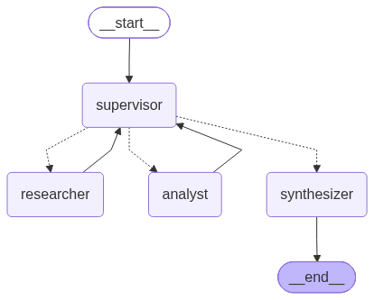
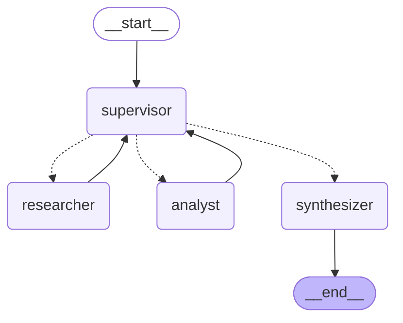
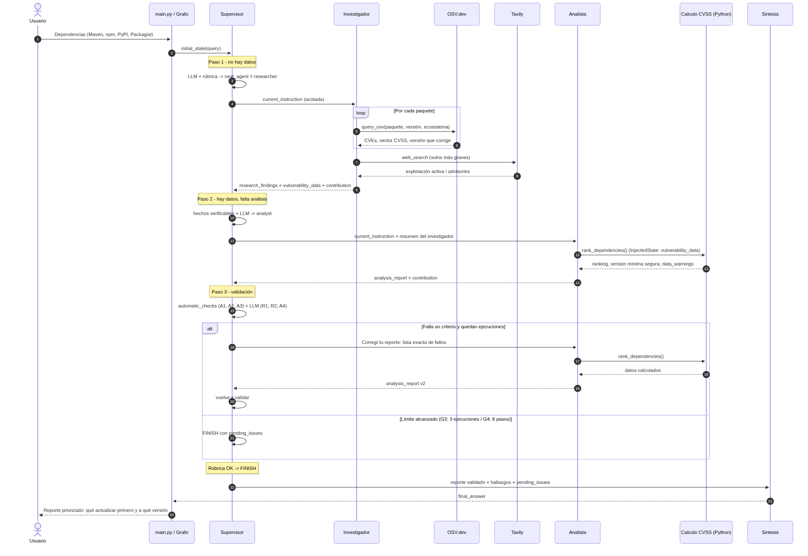
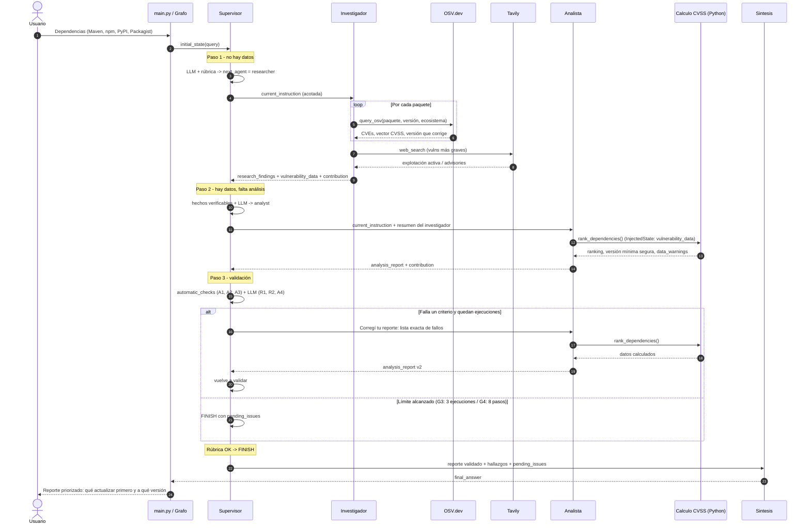

# Orquestador Multi-Agente de Vulnerabilidades

Recibe una lista de dependencias de **Java (Maven), JavaScript/Node (npm), Python (PyPI) y PHP (Packagist)**, y un supervisor coordina dos agentes especialistas:

- un **Investigador**, que busca las vulnerabilidades conocidas en OSV.dev y en la web;
- un **Analista**, que calcula el riesgo con CVSS y arma un plan de remediación.

Antes de dar el resultado por terminado, el supervisor **valida el trabajo con una rúbrica**. El sistema devuelve un reporte de **qué actualizar primero y a qué versión**.

> Pre-entrega 6: Orquestador multi-agente especializado (LangGraph)

---

## Diagrama del grafo



Generado con `graph.get_graph().draw_mermaid_png()` (`uv run python graph.py`):



- Las líneas punteadas son **aristas condicionales**: `route_from_supervisor()` devuelve `Literal["researcher", "analyst", "synthesizer"]`.
- Los especialistas **siempre vuelven al supervisor** y nunca hablan entre sí.

### Diagrama de secuencia



<details>
<summary>Código Mermaid (docs/sequence.mmd)</summary>



</details>

### Flujo típico

```
Usuario → Supervisor → Investigador → Supervisor → Analista → Supervisor (rúbrica)
                                                       ↑            │
                                                       └─ refinar ──┤ (si falla un criterio)
                                                                    └→ Síntesis → END
```

---

## Estructura del repositorio

```
├── state.py                  # Esquema del estado compartido (AgentState)
├── graph.py                  # StateGraph: nodos, aristas condicionales, diagrama
├── main.py                   # CLI que muestra la delegación paso a paso
├── tracing.py                # Observabilidad con Arize Phoenix (OpenInference)
├── demo.ipynb                # Notebook ejecutado con la demo del flujo
├── agents/
│   ├── research_agent.py     # Investigador (create_react_agent + OSV + Tavily)
│   ├── analyst_agent.py      # Analista (create_react_agent + InjectedState + CVSS)
│   ├── supervisor.py         # Router + rúbrica + guardrails
│   ├── synthesizer.py        # Síntesis final
│   └── llm.py                # Configuración única del LLM
├── tools/
│   ├── vuln_search.py        # query_osv (OSV.dev) y web_search (Tavily)
│   └── risk_analysis.py      # CVSS v3.1, priorización y versión mínima segura
├── tests/test_guardrails.py  # Tests sin LLM de la rúbrica y los frenos anti-bucle
└── docs/graph.png|.mmd       # Diagrama generado
```

---

## Cómo ejecutarlo

Requiere Python 3.12 y [uv](https://docs.astral.sh/uv/).

```bash
uv sync
cp .env.example .env        # completar OPENAI_API_KEY y TAVILY_API_KEY
uv run python main.py       # corre la consulta demo
uv run python main.py "Tengo express 4.17.1 (npm) y requests 2.25.0 (PyPI)"
uv run python -m pytest tests -q   # 12 tests, sin LLM ni red
```

- La key de Tavily es opcional: sin ella, el Investigador usa solo OSV.dev.
- Los tests importan los agentes, así que necesitan alguna `OPENAI_API_KEY` definida. Puede ser falsa, porque no se llama a la API.
- **`demo.ipynb`** está ejecutado y muestra cinco cosas:
  1. el diagrama;
  2. una consulta real con 4 ecosistemas;
  3. la tabla de trazabilidad;
  4. el bucle de refinamiento;
  5. los frenos contra el supervisor infinito.

---

## Observabilidad con Arize Phoenix

[tracing.py](tracing.py) instrumenta LangChain y LangGraph con **OpenInference**, sobre OpenTelemetry. Cada ejecución del grafo queda como **una traza** en Phoenix, con el árbol completo de la delegación:

```
vuln-orchestrator (LangGraph)
├── supervisor   ─ ChatOpenAI (decisión estructurada: SupervisorDecision)
├── researcher   ─ agente ReAct ─ ChatOpenAI ─ query_osv ×4 ─ web_search
├── supervisor
├── analyst      ─ agente ReAct ─ ChatOpenAI ─ rank_dependencies
├── supervisor
└── synthesizer  ─ ChatOpenAI
```

Para cada llamada al LLM se ven el prompt, la respuesta, los tokens y la latencia. Para cada herramienta, sus argumentos y su resultado. Cada corrida lleva un `session_id`, la consulta como metadata y tags (`using_attributes` en `main.py`).

En una corrida de prueba se registraron:

- 59 spans: 42 CHAIN, 8 LLM, 5 TOOL y 4 AGENT;
- unos 20.000 tokens.

```bash
uv run phoenix serve          # Phoenix local en http://localhost:6006
uv run python main.py         # en otra terminal: la traza aparece en el proyecto "vuln-orchestrator"
```

- **Es opcional.** Si Phoenix no está corriendo, el sistema avisa y sigue sin tracing. Para apagarlo del todo: `PHOENIX_TRACING=false`.
- **Phoenix Cloud:** definí `PHOENIX_COLLECTOR_ENDPOINT` y `PHOENIX_API_KEY` en `.env`.
- **Qué se puede analizar en Phoenix:**
  - por qué el supervisor eligió cada destino (la salida estructurada queda visible);
  - cuántos tokens consume cada agente;
  - cuánto tarda cada consulta a OSV;
  - cuántas iteraciones hizo cada agente ReAct.

### Análisis de tráfico y fallos

[docs/observability/analisis_observabilidad_phoenix.pdf](docs/observability/analisis_observabilidad_phoenix.pdf) documenta 11 trazas:

- 5 consultas complejas;
- 2 fallos provocados: herramientas caídas y un pedido fuera de alcance;
- 4 re-ejecuciones después de las correcciones.

Incluye el span de mayor latencia, el costo en tokens del razonamiento más largo y cómo se registran los errores. También documenta tres bugs encontrados navegando las trazas, que ya están corregidos.

```bash
uv run python scripts/generate_traffic.py     # tráfico + fault injection (Phoenix corriendo)
uv run python scripts/analyze_traces.py       # métricas y gráficos desde la API de Phoenix
uv run python scripts/build_report.py         # regenera el PDF
```

---

## Estado compartido ([state.py](state.py))

`AgentState` hereda de `MessagesState`. Cada campo tiene un dueño y una forma de combinarse con el valor anterior (*reducer*):

| Campo | Lo escribe | Reducer | Para qué |
|---|---|---|---|
| `messages` | todos | `add_messages` (acumula) | Historial de conclusiones, cada una firmada con `name=` |
| `user_query` | entrada | reemplaza | Consulta original |
| `next_agent` | supervisor | reemplaza | `Literal["researcher", "analyst", "FINISH"]` |
| `current_instruction` | supervisor | reemplaza | Instrucción **acotada** para el especialista |
| `step_count`, `revisions` | supervisor / especialistas | reemplaza | Contadores para los frenos anti-bucle |
| `research_findings` | investigador | reemplaza | Resumen en texto (siempre la última versión) |
| `vulnerability_data` | investigador | reemplaza | Datos **crudos de OSV**, sin pasar por el LLM |
| `analysis_report` | analista | reemplaza | Ranking y plan de acción |
| `pending_issues` | supervisor | reemplaza | Fallos de la rúbrica sin resolver al terminar |
| `contributions` | todos | `operator.add` (**acumula**) | **Registro auditable de quién aportó qué**: agente, paso, intento, instrucción y resultado |
| `final_answer`, `task_completed` | síntesis | reemplaza | Salida |

Los resultados de cada especialista **reemplazan** al valor anterior. Así, si el supervisor pide un refinamiento, el resto del sistema siempre lee la última versión. `contributions`, en cambio, **acumula**, y nunca se pierde quién aportó qué.

---

## Agentes y herramientas

Cada agente tiene **solo** las herramientas de su rol:

| Agente | Herramientas | Qué hace | Qué NO hace |
|---|---|---|---|
| **Investigador** | `query_osv`, `web_search` | Junta datos de OSV.dev (CVE, vector CVSS, CWE, versión que corrige) y contexto web | No prioriza ni recomienda |
| **Analista** | `rank_dependencies`, `calculate_cvss_score` | Calcula CVSS v3.1, rankea paquetes y calcula la versión mínima segura | No busca datos nuevos |
| **Supervisor** | ninguna: decide con salida estructurada | Enruta, valida y frena | No genera contenido técnico |
| **Síntesis** | ninguna | Redacta la respuesta final con lo ya validado | No cambia números ni orden |

**Decisiones clave:**

- **Los números los calcula Python, no el LLM.** CVSS v3.1 sale de la fórmula oficial, validada contra Log4Shell (10.0) y CVE-2022-31090 (7.7). El ranking, la versión mínima segura y el texto de las advertencias también se calculan en código. El LLM decide qué calcular y cómo explicarlo.
- **`InjectedState`.** El Analista llama a `rank_dependencies()` sin argumentos y LangGraph le inyecta `vulnerability_data` desde el estado. Así el LLM no tiene que reescribir unas 50 vulnerabilidades en JSON: gasta menos tokens y no puede alterar los datos.
- **Los datos de OSV se extraen de los resultados de la herramienta**, no del texto del LLM. El Investigador escribe un resumen, y los datos estructurados se guardan aparte, tal como llegaron.

### Criterio de priorización

El orden se decide por estos criterios, uno detrás del otro:

1. CVSS máximo;
2. cantidad de vulnerabilidades críticas;
3. cantidad de altas;
4. total de vulnerabilidades.

Así, una sola vulnerabilidad crítica pesa más que muchas medias. Una primera versión sumaba un bonus por cantidad, y django (9.8, con 66 vulnerabilidades) quedaba por encima de log4j (Log4Shell, 10.0). Se descartó por ser incorrecta desde el punto de vista de seguridad.

---

## ¿Por qué una topología jerárquica (Supervisor)?

1. **El problema tiene dependencias en orden.** El análisis necesita los datos de la investigación, así que hace falta alguien que controle la secuencia y decida cuándo un resultado "alcanza".
2. **Un único punto de validación.** El supervisor ve los resultados de todos y puede aplicar una rúbrica transversal antes del `END`. En una topología en red (agentes que se hablan entre sí), nadie tiene esa visión completa.
3. **Trazabilidad y control de costos.** Todo pasa por el supervisor, así que es fácil registrar las decisiones (`contributions`) y aplicar límites globales de pasos.
4. **Es fácil de ampliar.** Un nuevo especialista se agrega como un nodo más y una opción más en el `Literal`, sin tocar a los demás.

**Alternativas descartadas:**

- **Pipeline lineal** (investigador → analista → fin): no permite refinar.
- **Red de agentes** (todos con todos): riesgo de bucles entre agentes y responsabilidad difusa.

---

## Validación: rúbrica del supervisor

El supervisor decide en **tres capas**, de la más flexible a la más estricta:

### 1. Hechos verificables (Python)

`compute_facts()` y `automatic_checks()` calculan datos objetivos y se los pasan al LLM como contexto:

- qué paquetes se consultaron;
- cuáles quedaron recortados;
- cuántos scores son aproximados;
- si el reporte cumple los criterios objetivos.

### 2. LLM con rúbrica y salida estructurada

`with_structured_output(SupervisorDecision)`, con `next_agent: Literal[...]`. El LLM **no puede** responder un destino que no existe.

| Criterio | Quién lo evalúa |
|---|---|
| R1. Se consultaron todos los paquetes pedidos | LLM (compara la consulta con los hechos) |
| R2. Ninguna consulta falló sin explicación | LLM |
| A1. Todos los paquetes aparecen en el ranking | **Código** |
| A2. El orden coincide con el cálculo y cada fila tiene versión recomendada | **Código** |
| A3. Las advertencias son precisas (análisis parcial y scores aproximados) | **Código** |
| A4. El plan de acción es concreto y ordenado | LLM |

> **Lección aprendida:** al principio la rúbrica completa la evaluaba el LLM (gpt-4o-mini), y resultó **inconsistente**. En una corrida aprobó un reporte al que le faltaban advertencias. En otra rechazó uno correcto, inventando que "lodash no tiene versión". La solución fue dividir los criterios: **lo objetivo lo verifica el código y lo subjetivo lo juzga el LLM**.

### 3. Guardrails en código

Son reglas que el LLM no puede saltarse:

| Regla | Condición | Acción |
|---|---|---|
| G0 | Delegación con instrucción vacía | Instrucción por defecto |
| G1 | Pide el analista sin datos | Va al investigador |
| G2 | Pide FINISH sin análisis | Va al analista |
| G5 | Fallan los chequeos automáticos | El trabajo vuelve **al analista**, con la lista exacta de fallos |
| G6 | Pide un refinamiento sin un fallo concreto | No se rehace el trabajo |
| G3 | Un agente ya corrió `MAX_RUNS_PER_AGENT = 3` veces | FINISH |
| G4 | Se llegó a `MAX_STEPS = 8` | FINISH |

**Contra el supervisor infinito hay cuatro frenos independientes:**

- G3 y G4 (los límites de corridas y de pasos);
- G6 (no rehacer sin un motivo concreto);
- el `recursion_limit` de cada agente ReAct;
- el `recursion_limit` del grafo.

Si se termina con fallos sin resolver, quedan en `pending_issues` y la síntesis los muestra como advertencias, en vez de ocultarlos.

---

## Manejo de conflictos entre agentes

| Conflicto | Cómo se resuelve |
|---|---|
| El texto de un agente contradice los datos (p. ej. el analista dice "4 de 66" y OSV dice 15 de 66) | **Los hechos ganan.** Los chequeos automáticos lo detectan y el trabajo vuelve a su autor con el dato correcto. |
| El supervisor le pide al analista un orden distinto del calculado (pasó en las pruebas: "empezá por django") | **Los datos calculados ganan** sobre la instrucción. El analista mantiene el orden de `rank_dependencies`, aplica el resto de la instrucción y deja constancia del conflicto. |
| ¿A quién se le devuelve un error? (el LLM mandó un fallo del reporte al investigador) | **G5**: los fallos del reporte siempre vuelven al analista. Al investigador solo se vuelve con un problema real de investigación (R1/R2). |
| El analista necesita datos que no tiene | No puede buscarlos, porque no tiene la herramienta. Lo declara en "Datos faltantes", y el supervisor decide si vuelve al investigador. |
| Refinamientos que no convergen | G3 corta. Se termina con `pending_issues` visibles en el reporte final. |
| Dos versiones del mismo resultado | Los campos de resultados se reemplazan: siempre manda la última versión. El historial completo queda en `contributions`. |

---

## Cómo se evita la contaminación de contexto

Ningún agente recibe el historial completo:

- **Especialistas:** su nodo (`research_node`, `analyst_node`) arma un mensaje con solo la consulta del usuario, la instrucción del supervisor y, si es un refinamiento, su propia versión anterior. El agente ReAct corre en su **propio contexto** con sus mensajes internos, y al estado global vuelve **solo la conclusión**.
- **Supervisor:** ve los resultados, los hechos y los contadores. No ve los mensajes internos ni el JSON crudo.
- **Recortes:** `query_osv` reduce cada vulnerabilidad de unas 100 líneas de JSON a 8 campos, y analiza como mucho 15 por paquete. El recorte se avisa en el reporte.

---

## Ejemplo de salida

Consulta: `lodash 4.17.15 (npm), django 3.2.0 (PyPI), log4j-core 2.14.1 (Maven), guzzlehttp/guzzle 7.4.0 (Packagist)`

```
🧭 SUPERVISOR -> [paso 1] -> researcher.  Instrucción: Consulta las vulnerabilidades de ... en OSV.dev y la web.
🔎 RESEARCHER (ejecución #1): lodash 5 vulns, django 66, log4j-core 8 (CVE-2021-44228), guzzle 14 ...
🧭 SUPERVISOR -> [paso 2] -> analyst.     Instrucción: Analiza las vulnerabilidades y elabora un plan de remediación ...
📊 ANALYST (ejecución #1): ## Ranking de riesgo ...
🧭 SUPERVISOR -> [paso 3] -> FINISH. Todos los criterios de la rúbrica están cumplidos.
📝 SÍNTESIS FINAL
```

| Prioridad | Paquete | Versión actual | CVSS máx | Críticas/Altas | Actualizar a |
|---|---|---|---|---|---|
| 1 | log4j-core | 2.14.1 | 10.0 | 2/1 | 2.25.4 |
| 2 | django | 3.2.0 | 9.8 | 1/6 | 5.2.16 |
| 3 | lodash | 4.17.15 | 8.1 | 0/3 | 4.18.0 |
| 4 | guzzlehttp/guzzle | 7.4.0 | 8.0 | 0/6 | 7.15.2 |

Advertencias:

- log4j-core: 4 scores aproximados (sin vector CVSS v3).
- django: análisis parcial, 15 de 66 vulnerabilidades analizadas.

---

## Limitaciones

- Se analizan como mucho 15 vulnerabilidades por paquete, para acotar el contexto. El recorte se advierte en el reporte.
- CVSS v4 no se calcula: en esos casos se aproxima por la etiqueta de severidad, y se advierte.
- La "versión mínima segura" asume versionado comparable con `packaging`. Puede implicar un salto de versión mayor cuando la rama instalada ya no tiene soporte (por ejemplo, django 3.2 → 5.2).
- Los resultados dependen de que OSV.dev y Tavily estén disponibles.
